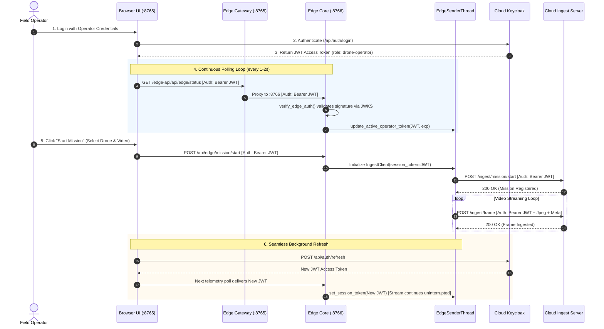

# DVAS — Phase E8: Dynamic Session Token Forwarding (Approach 2)

> **Document:** Phase E8 Technical Architecture & Modification Log  
> **Target System:** Kerala Police Drone Video Analytics System — Edge Operator Terminal (`DVAS_Edge_Setup_1.0.0.exe`)  
> **Workspace:** `D:\DVAS_KP` · **Git Branch:** `edge-exe-v1`  
> **Date:** November 2026  

---

## 1. Executive Summary

In Phase E8, the DVAS Edge Operator client was upgraded from **static per-laptop machine credentials** (Keycloak Resource Owner Password Credentials Grant with hardcoded client secrets and uploader passwords) to **Dynamic Session Token Forwarding (Approach 2)**.

With this change:
1. **Zero Configuration for Constables:** Police field constables never have to open or edit `.env` configuration files or deal with OAuth secrets.
2. **Pod-Immunity:** When the central cloud backend (e.g., RunPod) is recreated or redeployed and generates new Keycloak client secrets, the laptop `.exe` **never breaks**. As soon as the constable logs into the UI, their active login token is automatically multiplexed to authenticate the live frame ingestion stream.
3. **Decoupled Drone Hardware:** Drones are no longer bound to specific laptops. Constables can fly any drone (`DRN-001`, `DRN-002`, `DRN-005`, etc.) from any laptop.

---

## 2. Root Cause Analysis (Why the Previous Setup Failed)

During live trials on RunPod pod `g03m12pg2h741j`, the operator successfully logged into the Web UI (`edge_laptop_01@dvas.kp`), but starting a mission produced the following error:

```text
HTTP Request: POST https://g03m12pg2h741j-80.proxy.runpod.net/realms/kerala-police-drone/protocol/openid-connect/token "HTTP/1.1 401 Unauthorized"
edge_sender_frame_failed_buffering: {"error":"unauthorized_client","error_description":"Invalid client or Invalid client credentials"}
```

### Why it occurred:
* **M2M Token Grant Mismatch:** `edge_sender.py` attempted to obtain its own token via `POST /token` using `client_id=drone-ingest-client` and `client_secret` loaded from `edge.env`.
* **Pod Re-creation:** When RunPod pod IDs change (e.g., `erv9019...` → `4nrza3d...` → `g03m12p...`), Keycloak's client secret was reset in the cloud. The static `edge.env` on the laptop held the old secret.
* **The Operational Bottleneck:** Ordinary field officers cannot be expected to contact backend DevOps or edit hidden config files to update client secrets in the field.

---

## 3. Architecture: Dynamic Session Token Forwarding (Approach 2)

### High-Level Data & Token Flow



### Why this satisfies Central Security:
* The Central Ingest Server endpoint (`/ingest/frame`) validates that incoming requests contain:
  1. A valid cryptographic RS256 signature from Keycloak.
  2. An unexpired timestamp (`exp`).
  3. The `drone-operator` (or `sys-admin`) Keycloak role.
* The operator's active browser JWT satisfies **all three conditions completely**.
* Frame metadata (`drone_id`, `mission_id`, `gps`, `timestamp`) is conveyed in the request body, completely decoupled from the machine account name.

---

## 4. Code Changes Made in the Edge Codebase

### 4.0. `DVAS_Dashboard/frontend/src/pages/edge/MissionControl.js` (Dynamic Drone ID Input)

1. **No Dropdowns — Clean Numeric Input:**
   - The New Mission form now features a dedicated **Drone ID** asset field.
   - Built with a fixed, uneditable prefix block displaying **`DRN-`** and a clean numeric input field beside it.
   - Initial/default value is **`000`** (making the full Asset ID **`DRN-000`**).
   - Constables enter only the drone number (e.g., typing `001` or `010`). Non-alphanumeric characters are automatically sanitized.
   - Live badge below the input previews the exact ID: `Assigned Asset: DRN-001`.
   - On clicking **Start Mission**, `DRN-<number>` is sent to `/edge-api/api/edge/mission/start` in `drone_id`.

---

### 4.1. `dvas_edge/ingest/edge_sender.py` (Automatic Physical Machine Detection)

0. **Windows Computer Name Auto-Detection:**
   - Added `get_laptop_name()`: Reads `os.environ.get("COMPUTERNAME")` (falls back to `socket.gethostname()`).
   - Automatically sets `LAPTOP_ID = get_laptop_name()`.
   - If `INGEST__USERNAME` is not configured, it defaults dynamically to the physical laptop's Windows computer name (e.g. `LAPTOP-PATROL-03`).
   - Attaches `laptop_id`, `laptop_name`, and `uploader_username` to every frame's `metadata_json` sent to `/ingest/frame` and the mission start payload. HQ now automatically knows the exact physical laptop that uploaded the video for forensic and audit purposes.

1. **`IngestClient.__init__`**:
   - Added `session_token: Optional[str] = None` and `token_expiry: float = 0.0`.
   - Initialized `self.token = session_token` and `self.token_expiry = token_expiry`.
   - Defaulted `username` and `password` to empty strings (optional fallback).

2. **Added `set_session_token(token, expiry)`**:
   - Allows dynamically updating or renewing the active operator token in-memory while the background sender thread is actively transmitting frames.

3. **Updated `get_token()`**:
   - **Priority 1:** If the forwarded session token is present and valid (`time.time() < token_expiry - 15`), use it directly without making any external Keycloak calls.
   - **Priority 2:** If machine credentials are configured (`username`, `password`, `CLIENT_SEC`), attempt direct token acquisition. If that fails (e.g., secret mismatch), log a warning and fall back to the existing session token instead of crashing.
   - **Priority 3:** Retain the session token even during brief network renewal windows.

4. **Added `verify=_tls_param()`**:
   - Ensured `_acquire_token` respects the `INGEST__TLS_VERIFY` environment variable.

---

### 4.2. `dvas_edge/edge_api_server.py`

1. **`EdgeSenderThread.set_session_token(token, expiry)`**:
   - Exposed thread-safe token renewal method on the sender thread.

2. **Module-level Token Synchronization**:
   ```python
   _ACTIVE_OPERATOR_TOKEN: Optional[str] = None
   _ACTIVE_OPERATOR_TOKEN_EXPIRY: float = 0.0

   def update_active_operator_token(token: str, expiry: float = 0.0) -> None:
       """Propagate renewed JWT to in-flight IngestClient immediately."""
       global _ACTIVE_OPERATOR_TOKEN, _ACTIVE_OPERATOR_TOKEN_EXPIRY
       if not token:
           return
       _ACTIVE_OPERATOR_TOKEN = token
       _ACTIVE_OPERATOR_TOKEN_EXPIRY = expiry if expiry > 0 else (time.time() + 300)
       if pipeline and hasattr(pipeline, "sender_thread") and pipeline.sender_thread:
           pipeline.sender_thread.set_session_token(token, _ACTIVE_OPERATOR_TOKEN_EXPIRY)
   ```

3. **`verify_edge_auth()`**:
   - On every authenticated call from the frontend (such as telemetry polling every 1–2 seconds), extracts the verified JWT and expiration time, and automatically calls `update_active_operator_token()`.

4. **Route Updates (`/api/edge/mission/start` & `/api/edge/mission/toggle-ingest`)**:
   - `start_mission`: Passes `session_token=auth.get("token")` into `pipeline.start_mission()`, binding the active operator token to the ingest stream from frame 0.
   - `toggle_ingest`: Updates the session token whenever ingestion is toggled on/off.

5. **`get_jwks()` & Proxy Endpoints**:
   - Updated `get_jwks()` and `/api/ingest-server/status` proxy handlers to respect `INGEST__TLS_VERIFY=false` when running on self-signed or local test environments.

---

### 4.3. Packaging & Template Configuration

1. **`dvas_edge/packaging/config/edge.env.template`**:
   - Updated cloud proxy endpoints to the active pod: `https://g03m12pg2h741j-80.proxy.runpod.net`.
   - Documented that `INGEST__CLIENT_SECRET` and `INGEST__PASSWORD` are purely optional fallbacks.

2. **`dvas_edge/packaging/dvas_edge_installer.iss`**:
   - Pre-configured the installer wizard default Ingest URL to `https://g03m12pg2h741j-80.proxy.runpod.net/ingest`.

3. **Distribution Sync**:
   - Synchronized updated `edge_api_server.py` and `ingest/edge_sender.py` into `dvas_edge/packaging/dist/`.
   - Purged all `__pycache__` artifacts.
   - Recompiled installer binary `DVAS_Edge_Setup_1.0.0.exe` using Inno Setup 6.3.3.

---

## 5. Security & Governance Comparison

| Aspect | Old Design (Phase 1 Machine Accounts) | New Design (Phase E8 Approach 2) |
|---|---|---|
| **Credentials on Disk** | Machine client secret & password stored in plain-text `edge.env` | **No passwords or secrets stored on disk**. Only ephemeral session tokens in memory. |
| **Audit Log Attribution** | Ingest logs showed generic machine account (`edge_laptop_01`) | Ingest logs show the **actual police officer** who logged in (`operator_001`, `operator_002`). |
| **Pod Recreation Impact** | **Total failure (401)** until `edge.env` manually edited | **Zero downtime**. Officer logs in normally; stream uses fresh Keycloak signature. |
| **Drone Assignment** | Drone locked to laptop identity in config | Drone ID chosen dynamically by constable during Mission Start. |
| **Field Constable Friction** | High (must troubleshoot config files & secrets) | **Zero** (standard email/password UI login). |

---

## 6. Build Artifacts & Git Traceability

* **Compiled Installer:** `D:\DVAS_KP\dvas_edge\packaging\output\DVAS_Edge_Setup_1.0.0.exe`
* **Installer Size:** 150.5 MB (150,523,760 bytes)
* **Git Commit:** `f98ab9c` — *"feat(edge): implement session token forwarding for zero-touch ingest streaming (Approach 2)"*
* **Remote Branch:** `origin/edge-exe-v1`
* **Master Progress Log:** [`D:\DVAS_KP\dvas_edge\packaging\context.md`](file:///D:/DVAS_KP/dvas_edge/packaging/context.md)
